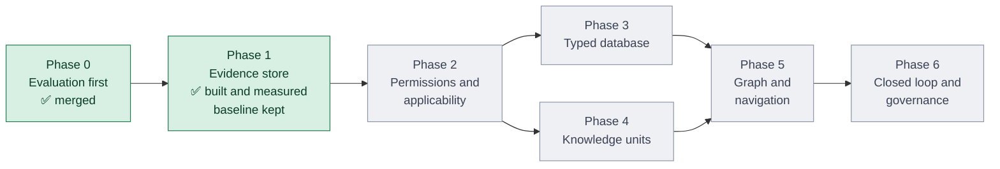

# agent-data-retrieval

> **Status: work in progress.** This repository is under active development and is not
> ready for use. So far it contains the research, the design, the Phase 0 evaluation
> harness, a recorded baseline and the Phase 1 evidence store with its `adr` tools. Phases 2–6
> are not built yet. Interfaces, file formats and results may change without notice.

An all-in-one toolkit that turns unstructured documents and tools into a data lake that AI
agents can retrieve from deterministically, built on schema engineering and graph
engineering. It targets domain-specific and rare knowledge, where general-purpose search
is weakest.

## Vision

An agent that answers a question about a rule, a procedure or an obscure fact should get
the same, best-supported evidence every time, and be able to show where it came from.

Today most retrieval stacks are tuned for popular knowledge, return different results from
run to run, and cannot say which version of which document an answer rests on. This project
aims for the opposite: one open toolkit that compiles any raw material into versioned data
products, turns each question into a structured query over those products, and retrieves
from a pinned snapshot so that the same question on the same data always returns the same
result, with every answer traceable to a stored span.

## Objectives

| Goal | What it means |
|---|---|
| **G1 Compile** | From raw documents in any form, build the data products that make later search work: a data lake of evidence with hashes and character spans, typed tables, typed relations, searchable knowledge units (rules, procedures, concepts, FAQs) and tool records. |
| **G2 Query understanding** | From a user's input, produce the structured form that best matches the G1 data products: which store, which operation, which filters and entities, and as of which date. |
| **G3 Retrieval** | Deterministically retrieve the best related results from those products, with quality measured separately for domain-specific and rare knowledge. |

Two terms are used precisely:

- **Deterministic** means: identical question + identical data snapshot ⇒ identical
  results. This is guaranteed by construction (pinned snapshots, fixed tie-breaks, no
  language-model call inside retrieval) and tested on every run.
- **Best related result** cannot be proven, only measured. That is why the evaluation
  harness comes first: every later component is accepted only if it beats the recorded
  baseline on its track without breaking determinism.

## Progress at a glance



| Phase | What it delivers | Status | Steps done | Progress |
|---|---|---|---|---|
| 0. Evaluation first | Golden question sets, the evaluation harness, a recorded baseline | ✅ Merged | 12 of 12 | `██████████` |
| 1. Evidence store | Record format, content-addressed store, structure-led chunks, hybrid search tools | ✅ Built and measured ([results](results/phase1/README.md)) | 6 of 6 | `██████████` |
| 2. Permissions and applicability | Access control on every record, version and validity filters, tools as data | Next | – | `░░░░░░░░░░` |
| 3. Typed database | Grounded extraction into typed tables, guarded SQL, identical rebuilds | Not started | – | `░░░░░░░░░░` |
| 4. Knowledge units | Rules, procedures and concepts as searchable records with citations | Not started | – | `░░░░░░░░░░` |
| 5. Graph and navigation | Statement graph and navigation tree, kept only if they beat Phases 1–4 | Not started | – | `░░░░░░░░░░` |
| 6. Closed loop and governance | Audits, gap mining, exporters, a public harness | Not started | – | `░░░░░░░░░░` |

Phases 3 and 4 can run in parallel. "Steps" are the steps in each phase's implementation plan,
so a bar shows work done, not quality reached: a phase counts as done only when its exit
criteria pass.

### Phase 1 steps

| # | Step | Purpose | Status |
|---|---|---|---|
| 1 | Metric definitions version 2 | Scoring rules that do not reward the wrong thing, settled before anything is measured against them | ✅ Merged ([`results/README.md`](results/README.md)) |
| 2 | Record format, structure parsers, store | A lossless, content-addressed record of every document and its sections | ✅ Built; 2,425 documents round-trip losslessly |
| 3 | Structure-led chunks | Chunks that follow headings and carry a breadcrumb | ✅ Built; a 1% edit re-embeds at most 0.6% of chunks |
| 4 | Retrieval over the store | Breadcrumb-weighted keyword search, dense search, an optional reranker | ✅ Built; reranker switched off (it lowers quality) |
| 5 | `search`, `read` and `grep` tools | The interface agents call, with a retrieval log | ✅ Built (`adr ingest`, `index`, `search`, `read`, `grep`) |
| 6 | Measure against the baseline | Keep each component only if it beats the baseline | ✅ Measured: level with the baseline, not better, so the baseline stays the reference ([`results/phase1/README.md`](results/phase1/README.md)) |

Design: [`docs/superpowers/specs/2026-11-13-phase1-evidence-store-design.md`](docs/superpowers/specs/2026-11-13-phase1-evidence-store-design.md).
Plan: [`docs/superpowers/plans/2026-11-13-phase1-evidence-store.md`](docs/superpowers/plans/2026-11-13-phase1-evidence-store.md).

## Plan

The roadmap runs from Phase 0 to Phase 6, and each phase is gated. The order follows one principle: build what is hard to
retrofit first. A phase is done only when its exit criteria pass in CI. The criteria are
design targets taken from the research, not results.

| Phase | Scope | Status |
|---|---|---|
| **0. Evaluation first** | Golden question sets over three corpora, an evaluation harness with five tracks (compile, query understanding, retrieval, determinism, end-to-end), and a recorded flat hybrid baseline (BM25 + dense). | **Merged**; three exit items still need outside input (see below) |
| **1. Evidence store and spec core** | Record spec with conformance tests, content-hash registry, per-page parse routing, structure-led chunks, hybrid search with reranking, `search` / `read` / `grep` tools, snapshot-tied indexes. | **Built and measured.** Three exit criteria met, one partly (no bounding boxes), one deferred (parse routing needs layout models), one not applicable. Retrieval is level with the baseline, which stays the reference ([results](results/phase1/README.md)) |
| **2. Permissions, applicability and tools as data** | Access-control principals on every row, version chains, validity and jurisdiction filters, deduplication, tool records ingested from MCP and OpenAPI. | Not started |
| **3. Typed deterministic database** | Schema contracts, grounded extraction with span checks, entity resolution, a semantic layer with guarded SQL, zero-call rebuilds with identical checksums. | Not started |
| **4. Knowledge units and enforcement** | Concepts, rule cards with citations, procedure records, FAQ and table records, executable rule bindings behind review and tests. | Not started |
| **5. Graph and navigation layers** | Bitemporal statement graph with typed graph tools, markdown navigation tree, facet taxonomy. Each layer is kept only if it beats the earlier phases on accuracy or tokens. | Not started |
| **6. Closed loop, interoperability and governance** | Gap mining and audits, spec v1.0, exporters to external catalogs and graph stores, a public neutral harness. | Not started |

The full roadmap with exit criteria is in
[`reports/Agent data retrieval research summary.md`](reports/Agent%20data%20retrieval%20research%20summary.md).

### Phase 0 status

| Item | Status |
|---|---|
| Evaluation harness (`adr-eval`): corpora, chunking, BM25 + dense index, golden generation and verification, scoring, statistics, runner, reports | Built; tests run in CI on Python 3.12 and 3.13 |
| Model backends: Claude Code subscription now; Anthropic, OpenAI-compatible, Gemini, DeepSeek, OpenRouter and self-hosted profiles ready for when API keys are added | Built ([`docs/eval/providers.md`](docs/eval/providers.md)) |
| Golden sets v0.1: `gov` 297 items, `research` 275 items, `bench` 728 items | Generated and verified automatically; 9 `gov` items removed after review ([`golden/gov/v0.1/README.md`](golden/gov/v0.1/README.md)). `gov` is committed; `research` and `bench` items stay local, pinned by hash in [`golden/research/v0.1/README.md`](golden/research/v0.1/README.md) and [`golden/bench/v0.1/README.md`](golden/bench/v0.1/README.md) |
| Baseline recorded (RRF and linear fusion, all five tracks) | Recorded with 1 repeat under version 2 of the metric definitions: [`results/README.md`](results/README.md). The version 1 numbers are kept in `results/v1/`. The 5-repeat run, which adds answer agreement, is not yet run |
| Judge agreement with human labels | Open: needs a human-labelled sample |
| Judge from a different model family than the generator | Open: needs a second provider |
| Human-vetted golden items | Open: items are model-drafted and code-checked only |

The only results so far are the baseline's own numbers. They describe a deliberately simple
system and are not a performance claim about the toolkit.

### Phase 1 results

Measured on the test split of all three corpora against `baseline-linear`
([`results/phase1/README.md`](results/phase1/README.md)):

| Question | Answer |
|---|---|
| Does the store keep every document intact? | Yes: 2,425 documents round-trip losslessly; every leaf element has a character span, every PDF leaf a page |
| Is re-indexing after an edit cheap? | Yes: editing 1% of documents re-embeds 0.03–0.55% of chunks |
| How long until 100 PDFs are searchable? | 8.4 minutes on a 4-core machine with all cores embedding |
| Is retrieval repeatable? | Yes: identical rankings across runs and rebuilds |
| Does it retrieve better than the baseline? | Only on gov (Recall@10 0.771 → 0.802, significant); level on research and bench |
| Are the answers better? | No significant difference on any corpus (accuracy 0.731 vs 0.752 on gov, 0.779 vs 0.806 on research, 0.813 vs 0.801 on bench) |
| Did the reranker help? | No: it lowered quality on every corpus and is switched off |

So the baseline stays the reference for later phases; the store, its spans and its tools are
what Phases 2–5 build on.

## What is in the repository

| Path | Contents |
|---|---|
| `reports/` | Five research reports, two methods catalogs, a combined summary and an HTML brief. |
| `research_notes/` | Working notes behind the reports. |
| `papers/` | Catalog of about 2,570 sources (`README.md`, `manifest.csv`). The PDFs are kept local only; rebuild them with `scripts/download_papers.py` (see the warning below). |
| `docs/superpowers/` | The Phase 0 design spec and implementation plan. |
| `src/adr_eval/`, `tests/` | The evaluation harness and its tests. |
| `src/adr_store/` | The Phase 1 evidence store: record format, structure parsers, content-addressed store, structure-led chunks, retrieval and the `adr` tools. |
| `config/` | Run settings, model profiles and price table. No API keys are stored here. |
| `corpora/` | Pinned manifests (SHA-256 per file) and notes for the three corpora. Corpus files download into `data/`, which is not committed. |
| `golden/` | Golden question sets: `gov` committed; `research` and `bench` items local only, with READMEs that pin their hashes and counts. |
| `results/` | Recorded baseline runs and their summary; Phase 1 results in `results/phase1/`. |

## Evaluation harness

Requires Python 3.12 or later. Dependencies are pinned to exact versions, because extracted text offsets and retrieval scores depend on them.

```bash
pip install -e ".[dev]"
```

```bash
adr-eval doctor
```

`doctor` prints one line per model profile and says which are usable. Then, for a corpus
(`gov`, `research` or `bench`):

```bash
adr-eval fetch gov
```

```bash
adr-eval index gov
```

```bash
adr-eval golden gov --verify
```

```bash
adr-eval run gov --system baseline-rrf --split test --repeats 5 --dry-run
```

`--dry-run` prints the number of model calls and the estimated cost without making any.
Drop it to run; add `--max-calls N` or `--max-dollars X` to cap a run. Then
`adr-eval report <run_id>` writes `report.json` and `report.md`.

Three corpora are used so that results do not rest on one kind of text:

| Corpus | Content |
|---|---|
| `gov` | US federal regulations at several dated versions, Internal Revenue Manual chapters and Federal Register metadata (public domain). |
| `research` | This repository's own reports, notes and source catalog, plus a fixed sample of 200 of the local PDFs. |
| `bench` | A 2,000-document subset of EnterpriseRAG-Bench (MIT) with its own questions. |

Reproducibility limits:

- `gov` is fetched from live government sites, and four Internal Revenue Manual pages are
  pinned by exact bytes. The corpus bytes are not committed, so if irs.gov changes those
  pages, `adr-eval fetch gov` fails with a hash mismatch and others can no longer rebuild
  the corpus or reproduce the `gov` baseline.
- `research` and its golden set are local only: the corpus needs the local PDF library,
  and the golden items quote the PDFs. Without the PDFs, `adr-eval fetch research` lists
  the missing files.
- `scripts/download_papers.py` rewrites the tracked `papers/manifest.csv`, which is a pinned
  `research` corpus document: rerunning it changes the research snapshot. Restore the file
  afterwards with `git checkout papers/manifest.csv`.
- Build corpora in a clean `data/` directory.

## Evidence store tools

The `adr` command works on one store and one index. For example, for loose files:

```bash
adr ingest --path <folder> --store <store>
```

```bash
adr index <store> --system p1-struct-bc --w-bc 2 --weight 0.9 --threads 0
```

```bash
adr search "<question>" --store <store> --top 10
```

```bash
adr read <doc_id> --store <store> --start 0 --end 500
```

```bash
adr grep "<pattern>" --store <store> --max 20
```

`adr ingest <corpus>` ingests a pinned corpus instead. `p1-struct-bc` needs its breadcrumb weight and fusion weight: give them with `--w-bc` and `--weight`, or with `--tuning <run>` to take the values an `adr-eval retrieval` run tuned on the dev split. `--json` gives machine-readable output, and
every call appends one line to `<store>/log/retrieval.jsonl`. `--threads 0` embeds on all cores;
the vectors are identical to single-threaded ones.

## License

Apache-2.0. See [`LICENSE`](LICENSE) and [`NOTICE`](NOTICE).
